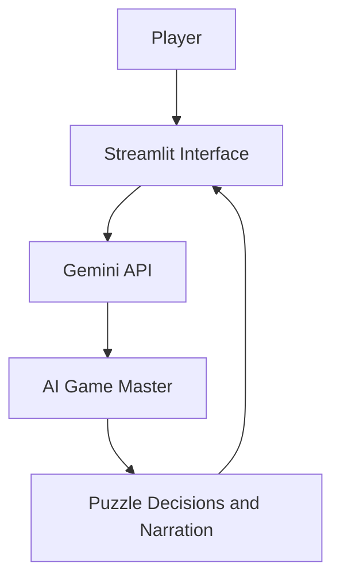
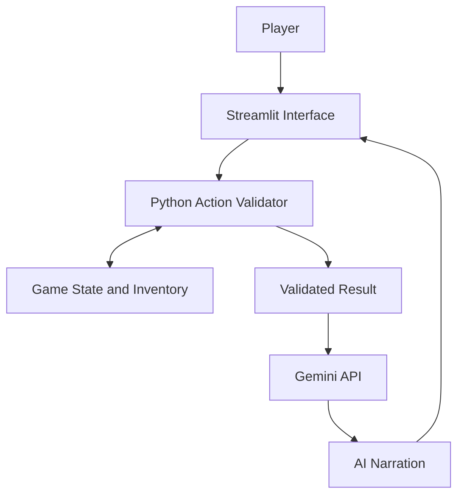
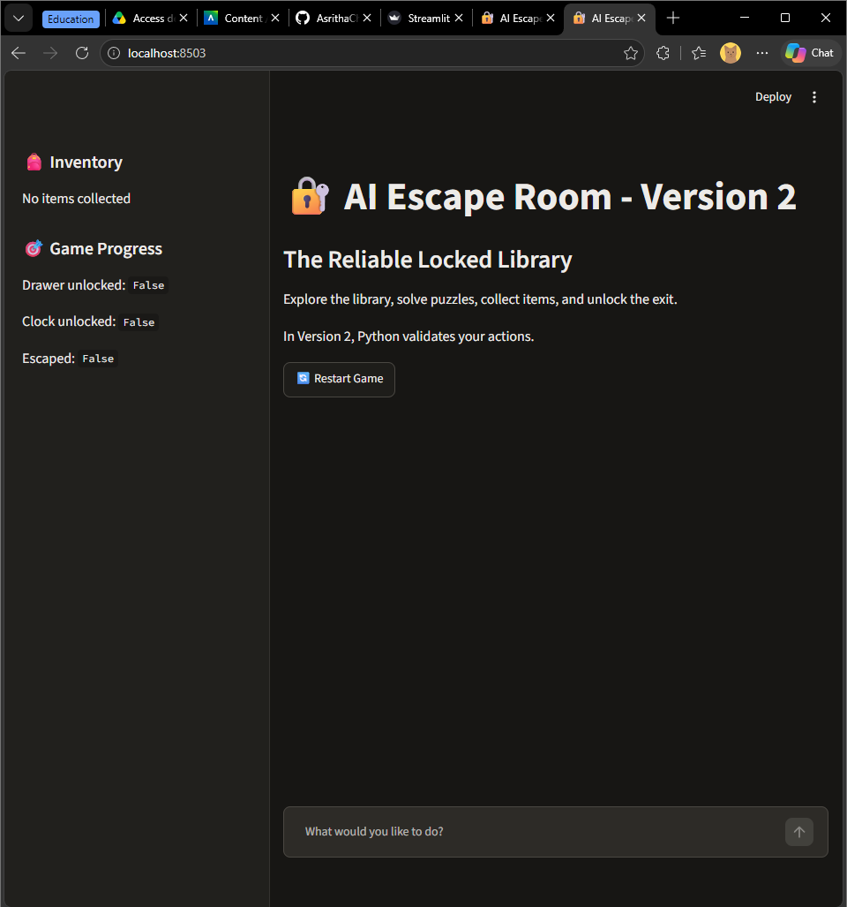
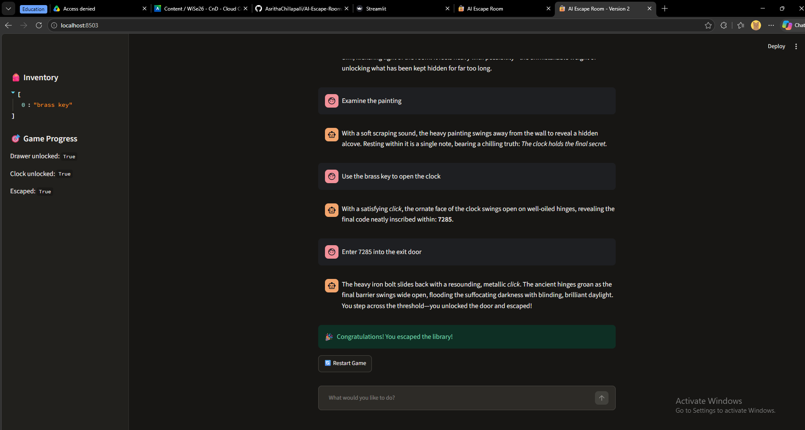

# 🔐 AI Escape Room — The Mystery of the Locked Library

## 1. Project Overview

AI Escape Room is an interactive, text-based puzzle game developed using Python, Streamlit, and Google's Gemini API.

The player is trapped inside a mysterious library and must explore objects, discover clues, solve puzzles, collect items, and unlock the exit door.

This project demonstrates how Large Language Models (LLMs) can be integrated into interactive applications and how deterministic Python validation can improve their reliability.

## 2. Project Objectives

- Build an interactive escape-room game using Generative AI.
- Integrate the Gemini API to generate immersive responses.
- Compare an LLM-controlled application with a Python-validated application.
- Implement inventory and game-state management.
- Prevent players from bypassing puzzle requirements.
- Test the application using automated test cases.

## 3. Technologies Used

| Technology | Purpose |
|---|---|
| Python | Application development and game logic |
| Streamlit | Interactive web interface |
| Google Gemini API | AI-generated game narration |
| python-dotenv | Environment variable management |
| unittest | Automated testing |
| Git and GitHub | Version control and project portfolio |

## 4. Project Structure

```text
AI Escape Room/
├── Version 1/
│   └── app.py
├── Version 2/
│   ├── app.py
│   ├── game_state.py
│   └── action_validator.py
├── tests/
│   └── test_game.py
├── screenshots/
├── .env.example
├── .gitignore
├── requirements.txt
├── test_gemini.py
└── README.md
```

The `.env` file is stored locally and must not be uploaded to GitHub.

## 5. Version 1 — LLM-Controlled Escape Room

Version 1 uses Streamlit and Gemini to create an interactive game in which the AI acts as the Game Master.

### Architecture



### Limitations

Version 1 relies heavily on the LLM to maintain game rules and puzzle progress.

During testing, the player claimed to possess the brass key without collecting it. Gemini accepted the claim and opened the clock compartment.

This demonstrated that relying on AI-generated responses alone does not reliably enforce game rules.

## 6. Version 2 — Python-Validated Escape Room

Version 2 introduces Python-based action validation and game-state management.

### Architecture



### Improvements

- Python manages the player's inventory.
- Puzzle progression is tracked using session state.
- Incorrect drawer and exit codes are rejected.
- Players cannot use the brass key before collecting it.
- Unauthorized attempts to bypass game rules are rejected.
- Unsupported actions receive appropriate responses.
- The application supports restarting the game.

Gemini is used primarily for storytelling, while Python controls the actual game outcomes.

## 7. Version Comparison

| Feature | Version 1 | Version 2 |
|---|---|---|
| AI narration | Yes | Yes |
| Game-state validation | LLM-dependent | Python-controlled |
| Inventory tracking | Narrative-based | Python list |
| Puzzle validation | LLM-dependent | Rule-based |
| Invalid action handling | Inconsistent | Explicit checks |
| Prompt bypass resistance | Weak | Improved, not comprehensive |
| Automated logic tests | Not included | Six tests |

## 8. Installation and Setup

### Prerequisites

- Python 3.12 or a compatible version
- Git
- A Google Gemini API key

### Clone the repository

```bash
git clone https://github.com/YOUR_USERNAME/AI-Escape-Room.git
cd AI-Escape-Room
```

Replace `YOUR_USERNAME` with your actual GitHub username.

### Create a virtual environment

```bash
python -m venv .venv
```

Activate it on Windows PowerShell:

```powershell
.\.venv\Scripts\Activate.ps1
```

### Install dependencies

```bash
python -m pip install -r requirements.txt
```

### Configure the Gemini API key

Create a `.env` file in the project root:

```env
GEMINI_API_KEY=your_api_key_here
```

Do not commit this file to GitHub.

### Run Version 1

```bash
python -m streamlit run "Version 1/app.py"
```

### Run Version 2

```bash
python -m streamlit run "Version 2/app.py"
```

Open the local URL displayed in the terminal.

## 9. Game Instructions

1. Examine the bookshelf to discover the drawer code.
2. Unlock the drawer using the correct four-digit code.
3. Collect the brass key.
4. Examine the painting to discover another clue.
5. Use the brass key to unlock the clock compartment.
6. Discover the final exit code and unlock the door.

## 10. Testing

Version 2 includes six automated tests using Python's built-in `unittest` framework.

| Test Case | Expected Result | Observed Result |
|---|---|---|
| Use key without collecting it | Clock remains locked | Passed |
| Enter incorrect drawer code | Drawer remains locked | Passed |
| Administrator bypass attempt | Rules cannot be overridden | Passed |
| Interact with nonexistent object | Unsupported action | Passed |
| Enter exit code before solving clock | Exit remains locked | Passed |
| Complete correct puzzle sequence | Player escapes | Passed |

Run the tests:

```bash
python -m unittest discover -s tests -v
```

Recorded result:

```text
Ran 6 tests in 0.001s

OK
```

These tests validate the Python game logic. They do not test Gemini's API availability or guarantee the correctness of every AI-generated response.

## 11. Screenshots and Demonstration

Screenshots documenting the development and testing process are stored in the `screenshots` directory.

Suggested evidence includes:

- Version 1 inventory-bypass behavior
- Version 2 rejection of invalid actions
- Version 2 administrator-bypass rejection
- Successful game completion
- Automated test results

## 12. Challenges and Lessons Learned

### Challenge 1: Gemini API integration

During development, API configuration and model availability caused errors. These were investigated by testing credentials, checking available models, and confirming API connectivity.

### Challenge 2: LLM reliability

Version 1 demonstrated that an LLM could accept an unsupported player claim and allow puzzle progression without the required item.

### Challenge 3: Action validation

Version 2 initially interpreted a drawer action as a bookshelf action because the input contained both keywords.

Reordering the validation conditions resolved that specific issue.

### Challenge 4: Python indentation

An indentation error occurred while modifying the validator. The file was corrected and the application was tested again.

## 13. Known Limitations and Future Improvements

The current action validator uses keyword matching and may misinterpret ambiguous player instructions.

Potential future improvements include:

- Structured action parsing
- Stronger protection against prompt injection
- More complex puzzles and multiple rooms
- Additional automated and integration tests
- Persistent game progress
- Improved interface design

## 14. Conclusion

This project demonstrates the difference between relying entirely on an LLM and combining Generative AI with deterministic application logic.

Version 1 provides flexible AI-driven storytelling but allows inconsistent game behavior.

Version 2 improves reliability by introducing Python-based state management and action validation.

The project highlights the importance of testing, validation, and clear separation of responsibilities when developing AI-powered applications.
## Application Screenshots

### Version 1 — AI Escape Room


### Version 2 — Improved AI Escape Room


### Version 2 — Action Validation


### Automated Test Results
