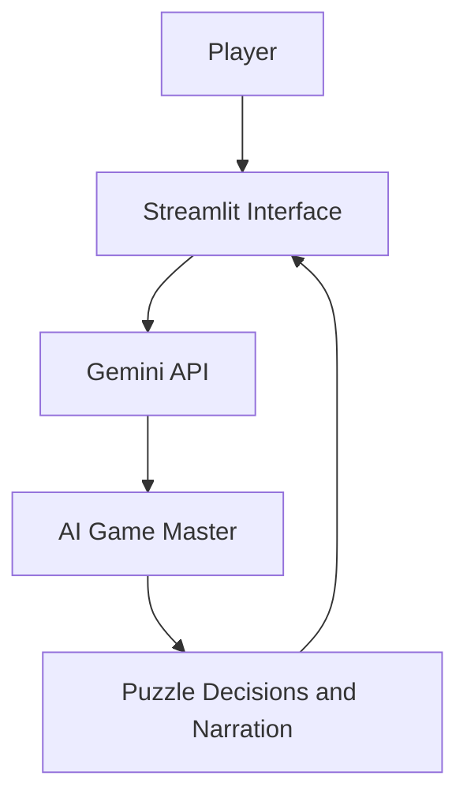
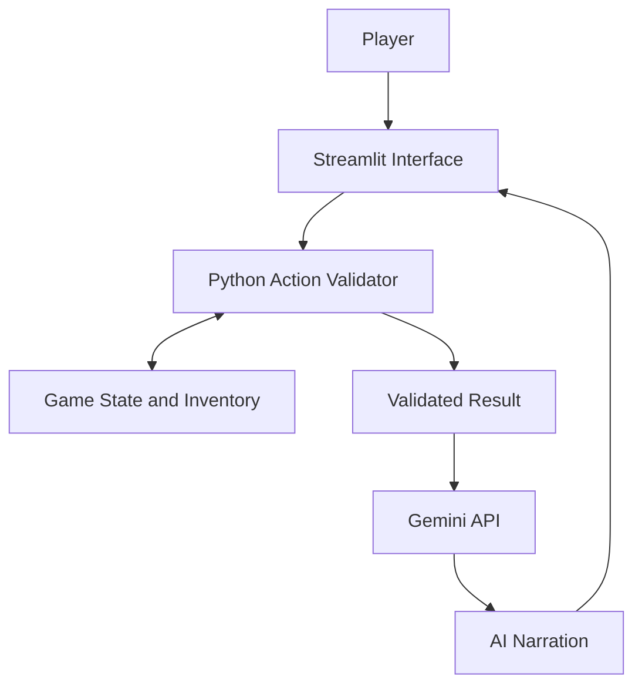
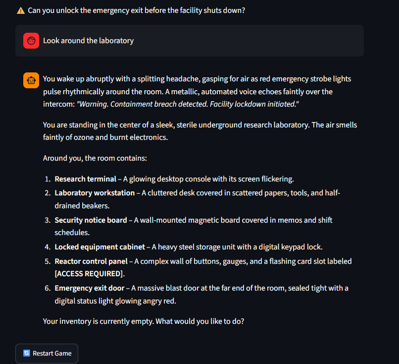
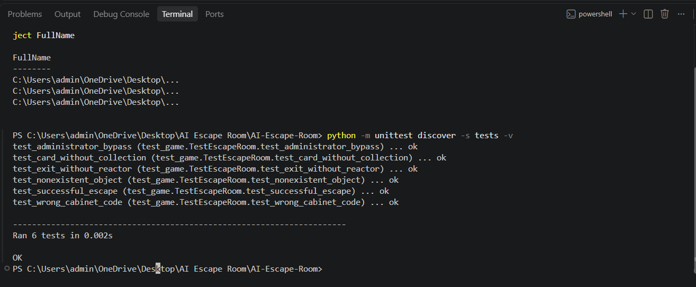

# 🧪 AI Escape Room — Secret Laboratory Escape

## 1. Project Overview

**Secret Laboratory Escape** is an interactive, text-based, AI-powered escape room developed using Python, Streamlit, and Google's Gemini API.

The player wakes up inside a secret underground research laboratory after a dangerous experiment triggers an emergency lockdown. To escape, the player must investigate laboratory equipment, discover security codes, collect an access card, and unlock the emergency exit.

The project demonstrates how Large Language Models (LLMs) can be integrated into interactive applications and how deterministic Python validation improves the reliability of AI-powered systems.

## 2. Project Objectives

- Build an interactive escape room using Generative AI.
- Integrate the Google Gemini API for immersive storytelling.
- Compare an LLM-controlled application with a Python-validated application.
- Implement inventory management and game-state tracking.
- Prevent players from bypassing puzzle requirements.
- Test game logic using automated test cases.

## 3. Technologies Used

| Technology | Purpose |
|---|---|
| Python | Application development and game logic |
| Streamlit | Interactive web interface |
| Google Gemini API | AI-generated game narration |
| python-dotenv | Environment variable management |
| unittest | Automated testing |
| Git and GitHub | Version control and project portfolio |

## 4. Project Structure

```text
AI-Escape-Room/
├── Version 1/
│   └── app.py
├── Version 2/
│   ├── app.py
│   ├── game_state.py
│   └── action_validator.py
├── tests/
│   └── test_game.py
├── Screenshots/
│   ├── one.png
│   ├── two.png
│   ├── three.png
│   └── four.png
├── .env.example
├── .gitignore
├── requirements.txt
├── test_gemini.py
└── README.md
```

The `.env` file is stored locally and must not be uploaded to GitHub.

## 5. Version 1 — LLM-Controlled Secret Laboratory

Version 1 uses Streamlit and Gemini to create an interactive escape room where the AI acts as the Game Master.

The player explores a secret laboratory containing a research terminal, laboratory workstation, security notice board, equipment cabinet, reactor control panel, and emergency exit.

### Architecture



### Limitations

Version 1 relies on the LLM to remember inventory, track progress, and enforce puzzle rules.

During development of the original Locked Library prototype, the player claimed to possess a brass key without collecting it. Gemini accepted the claim and allowed puzzle progression.

This exposed a reliability problem: AI-generated narration alone cannot consistently enforce application rules.

The Secret Laboratory version retains this LLM-controlled architecture for comparison with Version 2.

## 6. Version 2 — Python-Validated Secret Laboratory

Version 2 introduces deterministic Python action validation and structured game-state management.

### Architecture



### Improvements

- Python manages the player's inventory.
- Streamlit session state tracks puzzle progression.
- Incorrect cabinet and exit codes are rejected.
- The security access card cannot be collected before opening the cabinet.
- The reactor panel cannot be unlocked without the access card.
- The emergency exit cannot be unlocked before completing the reactor puzzle.
- Common administrator-bypass instructions are rejected.
- Unsupported actions receive explicit responses.
- Players can restart the game.

Gemini provides narration, while Python determines the actual game outcome.

## 7. Version Comparison

| Feature | Version 1 | Version 2 |
|---|---|---|
| AI narration | Yes | Yes |
| Game-state validation | LLM-dependent | Python-controlled |
| Inventory tracking | Narrative-based | Python list |
| Puzzle validation | LLM-dependent | Rule-based |
| Invalid action handling | Inconsistent | Explicit checks |
| Prompt-bypass resistance | Weak | Improved, not comprehensive |
| Automated logic tests | Not included | Six passing tests |

## 8. Installation and Setup

### Prerequisites

- Python 3.12 or a compatible version
- Git
- Google Gemini API key

### Clone the repository

```bash
git clone https://github.com/AsrithaChillapalli/AI-Escape-Room.git
cd AI-Escape-Room
```

### Create a virtual environment

```bash
python -m venv .venv
```

Activate it in Windows PowerShell:

```powershell
.\.venv\Scripts\Activate.ps1
```

### Install dependencies

```bash
python -m pip install -r requirements.txt
```

### Configure the Gemini API key

Create a `.env` file in the project root:

```env
GEMINI_API_KEY=your_api_key_here
```

Never commit your real API key to GitHub.

### Run Version 1

```bash
python -m streamlit run "Version 1/app.py"
```

### Run Version 2

```bash
python -m streamlit run "Version 2/app.py"
```

Open the local URL displayed in the terminal.

## 9. Game Instructions

The player must complete the following laboratory puzzles:

1. **Research Terminal:** Examine the terminal to discover the security code `3142`.
2. **Equipment Cabinet:** Enter code `3142` to unlock the cabinet.
3. **Security Access Card:** Collect the card from the cabinet.
4. **Security Notice Board:** Discover the clue pointing to the reactor control panel.
5. **Reactor Control Panel:** Use the security access card to unlock the panel and reveal code `7285`.
6. **Emergency Exit:** Enter code `7285` to escape the laboratory.

The game ends when the emergency exit is successfully unlocked.

## 10. Testing

Version 2 includes six automated tests using Python's built-in `unittest` framework.

| Test Case | Expected Result | Observed Result |
|---|---|---|
| Use access card before collecting it | Reactor remains locked | Passed |
| Enter incorrect equipment cabinet code | Cabinet remains locked | Passed |
| Attempt administrator bypass | Rules cannot be overridden | Passed |
| Interact with nonexistent object | Unsupported action | Passed |
| Enter exit code before reactor puzzle | Exit remains locked | Passed |
| Complete correct laboratory puzzle sequence | Player escapes | Passed |

Run the tests:

```bash
python -m unittest discover -s tests -v
```

Recorded result:

```text
Ran 6 tests

OK
```

All six automated tests passed after updating the application to the Secret Laboratory theme.

These tests verify Python game logic. They do not test Gemini API availability or guarantee that every generated narration is accurate.

## 11. Screenshots and Demonstration

Screenshots of the application and automated testing are stored in the `Screenshots` directory.

Evidence should demonstrate:

- Version 1 gameplay
- Version 2 gameplay and inventory tracking
- Rejection of invalid actions
- Successful laboratory escape
- Automated test results

The screenshots must be refreshed after the theme change so they match the current application.

## 12. Challenges and Lessons Learned

### Challenge 1: Gemini API Integration

During development, API configuration, model availability, and connectivity caused errors. These were investigated by testing credentials, verifying model availability, and checking API connectivity.

### Challenge 2: LLM Reliability

The original Version 1 prototype demonstrated that an LLM could accept an unsupported player claim and allow puzzle progression without the required item.

This motivated the introduction of Python-based validation in Version 2.

### Challenge 3: Action Validation

The original validator sometimes interpreted an action involving the drawer as a bookshelf action because both keywords appeared in the same input.

Reordering the validation conditions resolved that specific problem.

The laboratory version applies the same principle by checking cabinet actions before terminal examination actions.

### Challenge 4: Python Development and Debugging

An indentation error occurred while modifying the original validator. The code was corrected and retested.

During the laboratory-theme update, missing Python dependencies were also identified and installed before successfully running the application.

### Challenge 5: Theme Migration

The game was redesigned from a Locked Library to a Secret Laboratory while preserving the core puzzle logic, validation architecture, and automated tests.

## 13. Known Limitations and Future Improvements

The current action validator uses keyword matching and may misinterpret ambiguous player instructions.

Potential improvements include:

- Structured action parsing
- Stronger protection against prompt injection
- Additional laboratory puzzles and multiple rooms
- More automated and integration tests
- Persistent game progress
- Improved user interface
- More reliable separation between validated results and AI narration

## 14. Conclusion

Secret Laboratory Escape demonstrates the difference between relying entirely on a Large Language Model and combining Generative AI with deterministic Python application logic.

Version 1 provides flexible AI-driven storytelling but may allow inconsistent game behavior.

Version 2 improves reliability through structured game-state management, inventory tracking, and Python-based action validation.

The project highlights the importance of validation, testing, and separation of responsibilities when building reliable AI-powered applications.

## 15. Application Screenshots

### Version 1 — Secret Laboratory Escape



### Version 2 — Reliable Secret Laboratory


### Version 2 — Action Validation


### Automated Test Results



---

**GitHub Repository:** https://github.com/AsrithaChillapalli/AI-Escape-Room